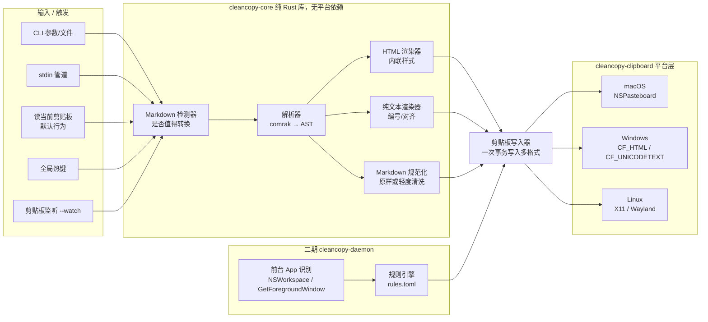

# CleanCopy 程序设计方案 v1

> 状态：草案 v1（2026-10-31）｜标"⚠️待验证"的内容是推断或依赖第三方行为，实现前需要实测。

---

## 1. 定位与一句话卖点

**定位**：一个跨平台、本地运行、零配置的"Markdown 智能复制"工具。它解决的是从 AI 编程助手（Claude Code、Codex、ChatGPT 等）复制出来的 Markdown 粘到别处就乱格式的问题。

**一句话卖点**：
> **复制一次，粘到哪里都对。** Word 里是排好的版，微信里是干净的纯文本，Obsidian 里还是 Markdown。

**需求依据**：Claude Code issue #18170（302 👍）及相关 issue，合计约 600 👍（数字由用户提供，README 引用前需要再核对一次，并附上原 issue 链接）。

**设计原则**
- 一次写入多种格式：剪贴板里同时放 HTML、整理过的纯文本、原始 Markdown，由目标 App 自己挑格式。MVP 不需要任何系统权限。
- 单个二进制、本地运行、不联网、不收集数据。
- CLI 优先：程序员最容易接受，也最好集成到 AI 工具里。

---

## 2. 用户场景

| # | 场景 | 现状痛点 | CleanCopy 之后 |
|---|---|---|---|
| S1 | 把 Claude Code 生成的方案粘进飞书文档或 Word 发给同事 | 满屏 `**`、`#`，表格变成竖线 | 原生标题、加粗、列表、表格、代码块 |
| S2 | 把 AI 回答粘进微信或钉钉发给非技术同事 | Markdown 符号刺眼，嵌套列表看不懂 | 去掉符号，用 1. 2. 3. 编号，缩进清晰 |
| S3 | 把 AI 输出存进 Obsidian 或 Typora 笔记 | 有时被转成 HTML 再转回来，格式有损 | 保持原始 Markdown |
| S4 | 写周报或邮件（Outlook、Gmail、Apple Mail） | 需要手动改格式 | 直接是富文本 |
| S5 | 终端里 `cat notes.md \| cleancopy` | 只能复制源码 | 一条命令写入多种格式 |
| S6（二期） | 习惯一律 Cmd/Ctrl+V | 微信会优先取富文本，偶尔异常 | 后台识别前台 App，强制使用编号纯文本 |

目标用户：重度使用 AI 编程助手的程序员，以及需要把技术内容转给非技术同事的人。

---

## 3. 整体架构



**数据流**：输入文本 → 检测是否为 Markdown → 解析成 AST → 三个渲染器分别输出 → 写入器在同一次剪贴板事务里写入全部格式。

---

## 4. 核心模块

### 4.1 检测器 `detect`
- 在 `--watch` 和热键模式下，需要判断剪贴板内容是否值得转换，避免误改普通文本。
- 启发式打分：出现 `^#{1,6} `、`^\s*[-*+] `、`^\s*\d+\. `、代码围栏 ```、表格分隔行 `|---|`、`**x**`、`[x](y)`，每命中一项加分，超过阈值才处理。阈值需要用真实语料调整（⚠️待验证）。
- 桌面热键输入优先使用显式 `text/markdown`；没有 Markdown 时，优先将 `text/html`（包括仅 HTML 的网页剪贴板）转为 Markdown，再走正常转换管线；最后才使用 `text/plain`。原始各格式快照保留，用于粘贴后的精确恢复。`--watch` 的保守检测策略不因此改变。
- **G-03 产品决定（2026-11-02）**：静默模式下，普通文本或超过 5 MiB 的文本直接粘贴原文，不转换、不弹菜单，即使目标 App 未识别。可转换的 Markdown + 未识别 App 才进入二级菜单（配置了固定回退格式时按回退执行）。关闭静默模式或显式完整菜单热键仍展示菜单；不可转换的格式选项禁用，默认选中原文。
- 超过 200 KiB 且不超过 5 MiB 的转换在后台线程执行，浮动菜单展示细进度条和「取消」；取消后不得写入剪贴板或发送粘贴。密码/安全输入模式下不展示菜单、不转换，并通知原因。
- CLI 显式调用时跳过检测，直接转换。

### 4.2 解析器 `parse`
- 使用 comrak，启用 GFM 扩展：表格、任务列表、删除线、自动链接、脚注。
- 输出 AST 后共享给三个渲染器，只解析一次。

### 4.3 三种渲染器
**HTML 渲染器**
- 基于 comrak 的 HTML 输出再做后处理，或者直接遍历 AST 自己输出。
- **样式全部内联**（`style="..."`），因为 Word、Outlook、飞书等会丢掉 `<style>` 和 class。
- 代码块：`<pre><code>`，内联等宽字体、浅灰背景。MVP 不做语法高亮，二期可以用 syntect 输出内联颜色。
- 表格：`<table border="1" style="border-collapse:collapse">`，单元格加 padding。
- 外层包一份完整的 `<html><body>…</body></html>`。Windows 平台还要加 `<!--StartFragment-->`/`<!--EndFragment-->` 标记。
- 任务列表用 ☐ / ☑ 字符，不用 `<input>`，因为很多 App 会把 `<input>` 丢掉。

**纯文本渲染器**：规则见第 7 节。

**Markdown 渲染器**
- 默认原样输出输入文本，只做三件事：统一换行符（Windows 上用 CRLF）、去掉首尾空白、去掉 AI 终端输出里可能夹带的 ANSI 转义序列。
- 可选 `--normalize`：用 comrak 的 CommonMark 格式化器重新输出。

### 4.4 剪贴板写入器 `clipboard`
统一接口：
```rust
pub struct Payload { pub html: String, pub plain: String, pub markdown: String }
pub trait ClipboardWriter { fn write(&self, p: &Payload) -> Result<()>; fn read_text(&self) -> Result<String>; }
```
- 三种格式必须在**同一次事务**里写入（一次 clear 加多次 set），否则后写入的会覆盖先写入的。
- 平台细节见 5.3 节。

### 4.5 触发方式
| 方式 | 阶段 | 说明 |
|---|---|---|
| CLI 参数/文件 | MVP | `cleancopy file.md` |
| stdin 管道 | MVP | `pbpaste \| cleancopy`，`claude -p ... \| cleancopy` |
| 无参数 | MVP | 读当前剪贴板纯文本，转换后写回。这是最常用的方式：在 AI 工具里复制，运行 cleancopy，再粘贴 |
| `--watch` 剪贴板监听 | MVP 后期 / v0.2 | 轮询剪贴板变化，macOS 用 `changeCount`，Windows 用 `AddClipboardFormatListener`，Linux X11 用 XFixes 或轮询。检测为 Markdown 时自动改写。用自己写入的 changeCount 防止死循环 |
| 全局热键 | v0.2 | 例如 Ctrl+Alt+C 表示"转换当前剪贴板"，用 `global-hotkey` crate。macOS 上可能需要辅助功能权限（⚠️待验证） |

### 4.6 规则引擎（二期）
- 常驻 daemon 识别前台 App：macOS 用 `NSWorkspace.shared.frontmostApplication.bundleIdentifier`，Windows 用 `GetForegroundWindow` → `GetWindowThreadProcessId` → 进程 exe 名。Linux X11 用 `_NET_ACTIVE_WINDOW`；Wayland 下基本做不到，明确不支持。
- 时机：由于无法拦截"粘贴"事件本身，有两种方案：
  - A. 前台 App 切换时，按新 App 的规则预先改写剪贴板（比如切到微信时，只保留纯文本）。实现简单，但切走后需要恢复多格式。
  - B. 拦截 Cmd/Ctrl+V 快捷键（macOS 用 CGEventTap，需要辅助功能权限；Windows 用低级键盘钩子 `WH_KEYBOARD_LL`），先改写剪贴板，再放行按键。更精确，但权限敏感，容易被杀软误报。
  - 推荐先做 A，B 作为可选项。
- 规则文件 `~/.config/cleancopy/rules.toml`：
```toml
[[rule]]
match = { bundle_id = "com.tencent.xinWeChat", exe = "WeChat.exe" }
mode = "plain"            # plain | html | markdown | multi
[[rule]]
match = { bundle_id = "md.obsidian", exe = "Obsidian.exe" }
mode = "markdown"
[default]
mode = "multi"
```
- 上面的 bundle id 和 exe 名都需要实机确认（⚠️待验证）。

---

## 5. 技术选型

### 5.1 语言对比
| 维度 | Rust | Go | Node/TS |
|---|---|---|---|
| 分发 | 单个静态二进制，体积小 | 单个二进制 | 需要运行时，或者用 pkg/bun 打包，体积大 |
| 剪贴板多格式 | `arboard` 支持 `set().html(html, alt_text)`；底层可用 `clipboard-win`、`objc2-app-kit` 精细控制 | 常见库 `golang.design/x/clipboard` 只支持文本和图片，写 HTML 要自己调 cgo 或 syscall（⚠️待验证最新版本） | `clipboardy` 只支持文本；写 HTML 要依赖原生模块或 Electron |
| Markdown 解析 | comrak（GFM 完整）、pulldown-cmark（快，但 GFM 支持较少） | goldmark（成熟） | markdown-it、remark（生态最好） |
| 常驻、钩子 | objc2、windows-rs 都能做 | 可以，但 cgo 较麻烦 | 较弱 |
| 程序员圈形象 | "用 Rust 写的"本身就有传播力 | 中 | 中 |
| 开发速度 | 中 | 快 | 快 |

### 5.2 Markdown 解析：comrak 还是 pulldown-cmark
- **comrak**：GitHub Flavored Markdown 兼容（表格、任务列表、删除线、自动链接、脚注），提供可遍历、可修改的 AST，自带 CommonMark 输出（可用于 `--normalize`）。
- **pulldown-cmark**：基于事件流，速度快、依赖少，表格和任务列表需要开启选项，但没有可修改的 AST，自己写纯文本渲染要维护状态机。
- **结论：用 comrak**。AI 输出的规模下性能不是瓶颈，AST 让纯文本渲染（嵌套编号、表格列宽）简单很多。

### 5.3 各平台剪贴板格式细节
**macOS（NSPasteboard）**
- `public.html`（`NSPasteboardTypeHTML`）：UTF-8 HTML。
- `public.utf8-plain-text`（`NSPasteboardTypeString`）：纯文本。
- Markdown：写入自定义 UTI `net.daringfireball.markdown`。哪些 App 会读取这个类型需要实测（⚠️待验证）。
- 一次 `clearContents` 之后，对同一个 pasteboard item 调用多次 `setString:forType:`。
- 可选：再写一份 `public.rtf`，因为部分老 App（如 TextEdit 的某些模式、部分 Office 版本）优先读 RTF。MVP 先不做，测试矩阵里观察是否需要。
- 实现：`objc2-app-kit` 直接调用；或者先用 arboard 写 HTML 加纯文本，再追加自定义类型。注意 arboard 内部会 clear，需要看它是否支持追加（⚠️待验证），不支持就自己写 macOS 后端。

**Windows**
- `CF_UNICODETEXT`：UTF-16 纯文本，换行用 CRLF。
- `HTML Format`（通过 `RegisterClipboardFormat("HTML Format")` 注册，俗称 CF_HTML）：**UTF-8 编码，带 ASCII 头部，偏移量按字节计算**：
```
Version:0.9
StartHTML:0000000105
EndHTML:0000000xxx
StartFragment:0000000141
EndFragment:0000000xxx
<html><body>
<!--StartFragment-->...<!--EndFragment-->
</body></html>
```
  - 偏移量是**UTF-8 字节数**，不是字符数。中文内容最容易算错，必须有单元测试。数字补零到固定宽度，方便先占位再回填。
  - 可选 `SourceURL:`。
- Markdown：注册自定义格式 `text/markdown`（Chromium、Electron 系的 App 对 MIME 风格的格式名可能有特殊映射，⚠️待验证）。
- 流程：`OpenClipboard` → `EmptyClipboard` → 多次 `SetClipboardData` → `CloseClipboard`。用 `clipboard-win` 或 `windows-rs`。
- 注意 `OpenClipboard` 会因其他进程占用而失败，需要重试，比如 10 次、每次间隔 20ms。

**Linux**
- X11：剪贴板是"所有者提供"模式。**进程退出后内容就消失**，所以 CLI 写入后必须 fork 出一个后台进程持有剪贴板，直到别的程序取得所有权。arboard 在 Linux 上提供 `SetExtLinux::wait()`，可配合 daemonize 使用。
  - 提供的 targets：`text/html`、`UTF8_STRING`、`text/plain;charset=utf-8`、`TEXT`、`text/markdown`。
- Wayland：`wl-copy` 一次只能提供一个 MIME 类型（⚠️待验证），所以多格式需要自己实现 `wlr-data-control` 或 `ext-data-control` 协议客户端（可参考 `wl-clipboard-rs`），或者用 arboard 的 Wayland 支持（需确认是否支持 html，⚠️待验证）。
- Linux 在 MVP 中定为"尽力支持"，主要面向 X11 和 XWayland。

### 5.4 推荐结论
- **语言**：Rust。
- **解析**：comrak。
- **剪贴板**：MVP 先用 arboard 快速打通 HTML 加纯文本；三格式写入和 CF_HTML 精确控制放在自己的 `cleancopy-clipboard` crate 里，macOS 用 `objc2-app-kit`，Windows 用 `clipboard-win`/`windows-rs`，Linux 用 arboard 或 `x11rb`。
- **CLI**：clap。**热键**：global-hotkey。**分发**：cargo-dist，生成 GitHub Release、Homebrew tap、Scoop/winget、shell 安装脚本。
- **核心库**编译成 WASM，供浏览器扩展复用（三期）。

---

## 6. CLI 设计

```bash
# 默认：读剪贴板 → 转换 → 写回三格式（最常用）
cleancopy

# 管道 / 文件
pbpaste | cleancopy
cat answer.md | cleancopy
cleancopy README.md
claude -p "写一份周报" | cleancopy

# 只写某一种格式（强制）
cleancopy --plain          # 只写编号纯文本（适合微信）
cleancopy --html           # 只写 HTML + 纯文本兜底
cleancopy --markdown       # 只写原始 Markdown

# 不写剪贴板，输出到 stdout（调试 / 脚本用）
cleancopy --print plain|html|markdown < a.md

# 监听模式
cleancopy --watch [--quiet] [--interval 300ms]

# 热键常驻（v0.2）
cleancopy daemon --hotkey "ctrl+alt+c"

# 诊断：列出当前剪贴板里有哪些格式及大小（调试测试矩阵很有用）
cleancopy inspect

# 配置
cleancopy config path|edit
```

退出码：0 成功；1 输入为空；2 剪贴板访问失败；3 参数错误。

配置文件 `~/.config/cleancopy/config.toml`（Windows 下为 `%APPDATA%\cleancopy\`）：纯文本风格（序号样式、表格模式）、HTML 主题、watch 阈值等。

---

## 7. 纯文本渲染规则

目标：粘到微信或记事本后，人能直接读懂，且没有 Markdown 符号。

| 元素 | 规则 | 示例输出 |
|---|---|---|
| 标题 H1 | 文字单独一行，前后各空一行；可选下方加 `====` 下划线（默认关闭，微信里不好看） | `项目背景` |
| H2–H6 | 默认用"【标题】"或直接文字，可配置 `heading_style = "plain" \| "bracket" \| "number"`；`number` 模式自动生成 1 / 1.1 层级编号 | `【技术选型】` |
| 加粗 / 斜体 / 删除线 | 去掉符号，保留文字（删除线保留文字可能造成误解，可选 `~~` 原样） | `重要` |
| 有序列表 | 按真实序号输出 `1. 2. 3.`（遵守起始编号） | `1. 第一项` |
| 无序列表 | **默认也用编号**（用户需求："用 1、2、3 编号"）；可配置为 `•` | `1. 苹果` |
| 嵌套列表 | 每层缩进 2 个全角空格或 4 个半角空格；二级编号 `1.1` / 或 `a) b)`；三级用 `-` | `   1.1 子项` |
| 任务列表 | `☐ 待办` / `☑ 已完成` | |
| 引用 | 每行前加 `> `，或者改为"「…」"（可配置） | |
| 行内代码 | 去掉反引号，原样保留内容（可选用「」包裹） | `运行 cargo build` |
| 代码块 | 保留内容和缩进；上下各加一行分隔线 `────────`；如有语言标注，第一行写 `[rust]`；**不改动内部任何字符** | |
| 链接 | `文字 (URL)`；文字和 URL 相同时只输出 URL；自动链接直接输出 URL | `文档 (https://…)` |
| 图片 | `[图片: alt] (URL)` | |
| 表格 | 默认"对齐文本表格"：按显示宽度对齐列（**中文按 2 宽度**，用 `unicode-width`），列间两个空格，表头下加 `──`；超宽（总宽 > 60 列）自动降级为"记录式"：每行转成 `列名：值` 分组 | 见下 |
| 分割线 | `────────` | |
| 脚注 | 正文中标 `[1]`，文末列出 | |
| HTML 内联标签 | 去掉标签，保留文字 | |
| 段落 | 段间空一行；连续空行压缩成一行 | |
| 换行符 | Windows 用 CRLF，其他平台用 LF | |

表格示例（对齐模式）：
```
语言    分发      生态
──────  ────────  ──────
Rust    单二进制  中
Go      单二进制  中
```
记录式（超宽降级）：
```
1. 语言：Rust；分发：单二进制；生态：中
2. 语言：Go；分发：单二进制；生态：中
```
> 微信用的是比例字体，对齐表格在微信里**不会真正对齐**（⚠️待验证程度）。因此针对微信的规则（二期）默认用记录式。

### 7.1 中文序号规则（「纯文本 · 中文序号」，实现：`crates/cleancopy-core/src/render_numbered.rs`）

1. **文档标题。** 如果文档里只有一个 H1，并且它是第一个块，这个 H1 就是文档标题：纯文本里不编号、单独成行；Word HTML / RTF 输出里映射为 Word 内置的「Title / 标题」样式（加粗）。文档里没有 H1 时，按同样的方式从 H2 开始编号。
2. **有标题（或没有 H1）时：** 中文风格 H2→`一、`，H3→`（一）`，H4→`1.`；H5、H6 不编号。
3. **有多个 H1（或唯一的 H1 不在开头）时：** 中文风格 H1→`一、`，H2→`（一）`，H3→`1.`；H4–H6 不编号。
4. **「一、1.（1）」风格：** 标题判断相同，之后三级依次为 `一、` → `1.` → `（1）`，更深的标题不编号。
5. 不编号的标题作为独立段落原样输出（Word 输出里仍是加粗的标题样式），不影响已编号标题的序号链（不会出现 `1.1.1.1`）。
6. **列表不参与标题编号。** 列表项不会让标题序号前进，也不会接着标题路径编号。
7. **列表自己的阶梯：** `1.` → `（1）` → `①` → `•`，更深的层级都用 `•` 项目符号。**列表起点对整篇文档统一（全局，不按章节）：** 先找出文档里任何已编号标题用到的最深一种编号形式，所有列表都从它的下一级开始。`一、`、`（一）` 只给标题用，所以标题最深只到 `（一）` 时列表从 `1.` 开始；文档里任何标题用了 `1.` 时，全文列表都从 `（1）` 开始（`（1）` → `①` → `•`）；用了 `（1）` 时从 `①` 开始。这样 H3 下的列表紧接着一个 H4 时，两者不会都是 `1.`。没有已编号标题的文档，列表从 `1.` 开始。
8. **相邻层级永远不共用同一种编号形式**（`•` 项目符号除外）。
9. 「1. 1.1 1.1.1」风格：H1 一律是不编号的标题，H2→`1.`、H3→`1.1`、H4→`1.1.1`；H5、H6 不编号（纯文本里只输出文字，Word HTML / RTF 里保持加粗的标题样式）。标题用了 `1.`，所以列表从 `（1）` 开始，列表中间夹段落时继续编号。两种中文风格每个列表从头编号。遇到新标题都重新编号。

示例（中文风格）：`# 周报 / ## 进展 / - 完成` → `周报` / `一、进展` / `1. 完成`；`# 甲 / ## 乙 / # 丙` → `一、甲` / `（一）乙` / `二、丙`。

测试：`crates/cleancopy-core/tests/numbered.rs`，包括 `list_base_is_global_to_the_deepest_heading_scheme`（H3 下的列表紧跟 H4）、`lists_start_below_the_nearest_heading_scheme`、`single_leading_h1_is_title_and_multiple_h1s_are_numbered`、`unnumbered_deep_headings_are_standalone`；Word 标题样式见 `tests/desktop_html_detection.rs` 与 `tests/rtf.rs`；相邻层级不重复的属性测试在 `tests/numbered_levels.rs`。

---

## 8. 与 Claude Code / Codex 集成

前提：CleanCopy 是本地 CLI，所有集成都通过"调用 `cleancopy` 命令"来实现，不依赖私有 API。以下 Claude Code 和 Codex 的扩展机制名称、文件位置，以官方最新文档为准（⚠️待验证）。

1. **Claude Code 自定义 slash 命令**：在仓库 `integrations/claude-code/commands/copy.md` 提供命令定义，用户放进 `~/.claude/commands/`。效果：`/copy` 让 Claude 把上一条回答（或指定内容）通过 Bash 执行 `cleancopy` 写入剪贴板，例如 `printf '%s' "$CONTENT" | cleancopy`。注意长文本需要用 heredoc 传递，避免转义问题。
2. **Claude Code Skill**：提供 `integrations/claude-code/skills/cleancopy/SKILL.md`，描述"用户说'复制到剪贴板'或'我要粘到 Word/微信'时，把内容通过管道交给 `cleancopy`，粘微信时加 `--plain`"。
3. **Hook（可选，默认不启用）**：在 Stop hook 里把最后一条回答自动交给 `cleancopy`。缺点是会覆盖用户剪贴板，侵入性强，只在文档中作为可选方案。需要确认 hook 的输入里是否能拿到回答正文（⚠️待验证）。
4. **Codex CLI**：提供同等的自定义 prompt 或指令片段（AGENTS.md 片段），教 Codex 在需要时调用 `cleancopy`（⚠️待验证 Codex 当前的扩展机制）。
5. **通用**：`--watch` 模式不需要任何集成，对 ChatGPT 网页、Cursor 等都有效，这是"零集成"卖点。
6. 一条命令安装集成：`cleancopy integrate claude-code`（v0.2），自动把命令文件复制到对应目录。安装前先询问用户确认。

---

## 9. MVP 范围与里程碑

**MVP（v0.1）范围**
- ✅ CLI：无参数读剪贴板、stdin、文件；`--plain/--html/--markdown/--print`；`inspect`
- ✅ comrak 解析加三个渲染器（含中文宽度表格对齐）
- ✅ macOS、Windows 三格式写入（含正确的 CF_HTML）
- ✅ Linux X11 HTML 加纯文本（尽力支持）
- ✅ Claude Code slash 命令和 Skill 文件
- ✅ 金样测试（golden test）和测试矩阵的手工测试记录
- ✅ 纯文本编号按第 7.1 节：列表起点按全文最深的标题编号形式统一确定（`（1）` → `①` → `•`），「1. 1.1 1.1.1」风格 H5+ 不编号
- ❌ 不做：热键、daemon、规则引擎、GUI、浏览器扩展、语法高亮

**按周里程碑**（假设每周 10–15 小时业余时间，⚠️估算）
| 周 | 目标 | 交付 |
|---|---|---|
| W1 | 仓库骨架、comrak 解析、纯文本渲染器、golden test | `cleancopy --print plain` 可用 |
| W2 | HTML 渲染器（内联样式）、macOS 写入器（三格式）、`inspect` | macOS 上粘贴 Word、飞书、备忘录可用 |
| W3 | Windows 写入器（CF_HTML 偏移、UTF-16、重试）、Linux X11 加后台持有剪贴板 | 三平台可用 |
| W4 | 测试矩阵实测与修复、cargo-dist 发布、Homebrew/Scoop、Claude Code 集成文件、README 和演示 GIF | **v0.1.0 发布** |
| W5 | `--watch`（含 Markdown 检测器）、根据第一批 issue 修 bug | v0.2.0 |
| W6 | 全局热键、`integrate` 子命令、配置文件 | v0.2.x |

---

## 10. 二期与三期规划

**二期（v0.3–v0.5）：按 App 智能**
- daemon 常驻（macOS 用 LaunchAgent，Windows 用开机启动项）加托盘图标（`tray-icon` crate）
- 前台 App 识别加规则引擎（第 4.6 节），内置常用 App 规则：微信、QQ、钉钉、企业微信、Slack、Notion、Obsidian、Typora、终端
- macOS 辅助功能权限引导（检测 `AXIsProcessTrusted`，并给出引导文案）
- 代码块语法高亮（syntect，输出内联样式）
- 写入 RTF（如果测试矩阵显示有需要）
- 数学公式：`$…$` 在 HTML 中输出 Unicode 或图片（需评估）

**三期（v1.x）：生态**
- 浏览器扩展（Chrome/Edge/Firefox）：core 编译成 WASM，扩展通过 `navigator.clipboard.write([new ClipboardItem({'text/html':…, 'text/plain':…})])` 写多格式。**浏览器只能用多格式方案，无法识别目标 App**；自定义 `text/markdown` 在 Web Clipboard API 中只能作为 `web ` 前缀的自定义格式，原生 App 基本读不到（⚠️待验证）。可在 ChatGPT、Claude.ai 页面的"复制"按钮旁注入"Clean Copy"按钮（DOM 变化需要持续维护）。
- VS Code / Cursor 扩展：命令"Copy as Rich Text"。
- 轻量 GUI 设置面板（Tauri）。
- 自定义 HTML 主题（飞书风格、GitHub 风格），以及插件化渲染钩子。

---

## 11. 测试矩阵

图例：H=期望取 HTML，P=期望取纯文本，M=期望取 Markdown；每格实测记录"✅/⚠️/❌ + 实际取了哪种格式"。

| 目标 App | 期望 | macOS | Windows | Linux | 备注 |
|---|---|---|---|---|---|
| Microsoft Word | H | | | — | 检查表格边框、代码块等宽字体 |
| WPS 文字 | H | | | | ⚠️ 对 HTML 的支持程度待测 |
| 飞书文档 | H | | | | 网页版和客户端都要测 |
| 飞书 / 钉钉聊天 | H 或 P | | | | |
| Outlook / Apple Mail / Gmail 网页 | H | | | | Outlook 对 CSS 支持差 |
| Google Docs / Notion | H | | | | Notion 可能自行识别 Markdown 纯文本 |
| 微信（PC） | P | | | — | ⚠️ 是否会取 HTML 待测，这是二期规则引擎的主要动机 |
| QQ / 企业微信 | P | | | | |
| 记事本 / TextEdit 纯文本模式 | P | | | gedit | TextEdit 富文本模式会取 HTML |
| 终端（Terminal/iTerm2/Windows Terminal/GNOME Terminal） | P | | | | 多行粘贴提示 |
| VS Code | M（实为 P 通道） | | | | VS Code 默认粘贴纯文本；新版有"粘贴为…"功能，可能用到 HTML（⚠️待验证） |
| Obsidian | M | | | | ⚠️ Obsidian 默认会把粘贴的 HTML 转成 Markdown（可能会把表格、代码块转坏）；验证 HTML 转换结果，如有问题，文档指引使用 Cmd/Ctrl+Shift+V（纯文本粘贴），或关闭"粘贴时自动转换 HTML"设置（设置名待确认），二期规则直接对 Obsidian 只写 Markdown |
| Typora | M | | | | ⚠️ Typora 会把 HTML 转为 Markdown，可能和原文不完全一致；同样提供纯文本粘贴方案和二期规则 |
| Logseq / 思源笔记 / Joplin | M | | | | ⚠️ 同上，待测 |
| Slack | H 或 P | | | | |

**Markdown 编辑器问题的验证方法**
1. 准备标准测试文档 `fixtures/kitchen-sink.md`（各级标题、嵌套列表、表格、代码块、链接、中英混排）。
2. 用 CleanCopy 复制后粘贴到编辑器，保存文件，用 `diff` 和原始 Markdown 比较。
3. 对比 `cleancopy --markdown`（只写纯文本通道）的结果。
4. 结论写进 `docs/compat.md`。若 HTML 粘贴有损，三种对策：文档说明纯文本粘贴快捷键；提供 `--markdown` 模式；二期规则自动处理。

**自动化测试**
- 单元测试和 golden test：`fixtures/*.md` → `expected/*.{html,txt}`，用 `insta` 做快照。
- CF_HTML 偏移量测试：中文、emoji、空内容。
- 平台集成测试：在 GitHub Actions 的 macOS、Windows runner 上写入剪贴板再读回，校验格式列表（runner 能否访问剪贴板需要验证，⚠️待验证）；Linux 用 Xvfb。

---

## 12. 风险

| 风险 | 影响 | 应对 |
|---|---|---|
| 目标 App 选择格式的行为不可控（同一 App 不同版本行为不同） | 核心体验 | 测试矩阵加 `inspect` 诊断，鼓励用户提交兼容性报告，二期规则引擎兜底 |
| Markdown 编辑器优先取 HTML 后转换有损 | S3 场景失败 | 见第 11 节的对策 |
| CF_HTML 偏移计算错误导致乱码或截断 | Windows 全部失效 | 按字节计算、完整测试 |
| Linux 剪贴板持有、Wayland 多格式 | Linux 体验差 | 明确"尽力支持"，后台持有进程，记录已知问题 |
| `--watch` 误判普通文本、改写用户剪贴板 | 用户反感 | 检测阈值保守、已有 HTML 时不处理、可快速关闭，并支持撤销（保存上一份） |
| 二期权限（辅助功能、键盘钩子）被杀软误报或用户不信任 | 安装转化率 | 默认不开启、开源可审计、Windows 签名（证书有成本）、macOS 公证（需要 Apple 开发者账号年费） |
| AI 工具官方自己修复了复制格式问题 | 需求减弱 | 定位为"任意 Markdown → 任意 App"的通用工具，不仅限于 AI；规则引擎和中文场景（微信、飞书、WPS）是差异点 |
| 已有同类工具（如 pandoc 加脚本、各种 "markdown to clipboard" 小工具） | 差异化 | 发布前调研竞品并在 README 中坦诚对比（⚠️待调研） |
| 业余时间不足 | 进度 | MVP 严格砍范围，W4 必须发布 |

---

## 13. 仓库结构

```
cleancopy/
├── Cargo.toml                  # workspace
├── crates/
│   ├── cleancopy-core/         # 纯逻辑：detect / parse / render(html, plain, md)，无平台依赖，可编 WASM
│   │   ├── src/{lib,detect,render_html,render_plain,render_md,width}.rs
│   │   └── tests/golden.rs
│   ├── cleancopy-clipboard/    # 平台写入器
│   │   └── src/{lib,macos,windows,linux,cf_html}.rs
│   ├── cleancopy-cli/          # clap 入口，二进制名 cleancopy
│   └── cleancopy-daemon/       # 二期：热键、watch、前台 App、规则引擎
├── fixtures/                   # 测试输入 .md（含 AI 真实输出样例，已脱敏）
├── tests/snapshots/            # insta 快照
├── integrations/
│   ├── claude-code/{commands/copy.md, skills/cleancopy/SKILL.md}
│   └── codex/AGENTS.snippet.md
├── docs/{compat.md, plain-text-rules.md, config.md, design.md}
├── assets/demo.gif
├── .github/workflows/{ci.yml, release.yml}   # cargo-dist
├── README.md / README.zh-CN.md
├── CHANGELOG.md / CONTRIBUTING.md
└── LICENSE                     # MIT 或 Apache-2.0 双许可（Rust 生态惯例）
```

---

## 14. README 卖点与发布传播建议

**README 结构**
1. 标题加一句话：`CleanCopy — Copy Markdown once, paste perfectly anywhere.`（中文："复制一次，粘到哪里都对"）
2. **对比 GIF**（最重要）：左边是直接粘贴到 Word 或微信的乱码效果，右边是用 CleanCopy 之后的效果。用同一段 Claude Code 输出录制。
3. "为什么需要它"：引用 Claude Code issue #18170 等真实 issue（附真实链接和截图，👍 数在发布当天重新核对）。
4. 30 秒上手：`brew install …` / `scoop install …` / `cargo install cleancopy`，然后运行 `cleancopy`。
5. 工作原理：一张图说明多格式剪贴板。程序员喜欢看原理，这也是技术身份的展示点。
6. 兼容性表（链接到 `docs/compat.md`）。
7. Claude Code / Codex 集成。
8. 路线图、贡献指南（"good first issue"：新增某个 App 的兼容性测试）。

**传播建议**
- **第一站**：在原始的 Claude Code issue 下礼貌地回复一次"我做了一个开源工具解决这个问题"，附链接。只发一次、不刷屏，遵守仓库规则；相关 issue 同理。这是最精准的种子用户来源。
- 中文社区：V2EX（分享创造节点）、掘金或少数派技术文章（《为什么从 AI 复制的 Markdown 粘到 Word 会乱：剪贴板多格式原理》）、即刻、X 中文圈。
- 英文社区：Hacker News "Show HN"、Reddit r/ClaudeAI、r/rust（侧重 CF_HTML 和多格式剪贴板的实现细节）、X。
- 技术博文是立住身份的关键：写两三篇深度文章，例如 CF_HTML 字节偏移的坑、macOS 剪贴板 UTI、Linux 剪贴板为什么进程退出就没了。比单纯宣传产品更有长尾效应。
- 节奏：v0.1 软发布（issue 加 V2EX）→ 收集反馈修一周 → v0.2（`--watch`）再发 HN 和 Reddit → 二期规则引擎作为第三波话题。
- 指标：GitHub star、Release 下载量、兼容性 issue 数量。不设具体目标数字，以实际数据为准。
- 维护形象：issue 48 小时内回复，用 CHANGELOG 和 Release Notes 体现持续迭代。

---

## 附：待验证清单（汇总）
1. issue #18170 及相关 issue 的👍数和链接（发布前核对）
2. arboard 是否支持在 HTML 之外追加自定义格式；Linux 上 arboard 和 Wayland 是否支持 html
3. `wl-copy` 是否支持多 MIME
4. 各 App 实际取哪种格式（整个测试矩阵），重点：微信、WPS、Obsidian、Typora、VS Code
5. Obsidian 关闭 HTML 自动转换的设置项名称
6. macOS 全局热键是否需要辅助功能权限
7. Claude Code slash 命令、Skill、hook 的最新格式和 hook 能否拿到回答正文；Codex 的扩展机制
8. GitHub Actions runner 上的剪贴板可用性
9. Web Clipboard API 自定义格式在原生 App 中是否可读
10. 竞品调研
